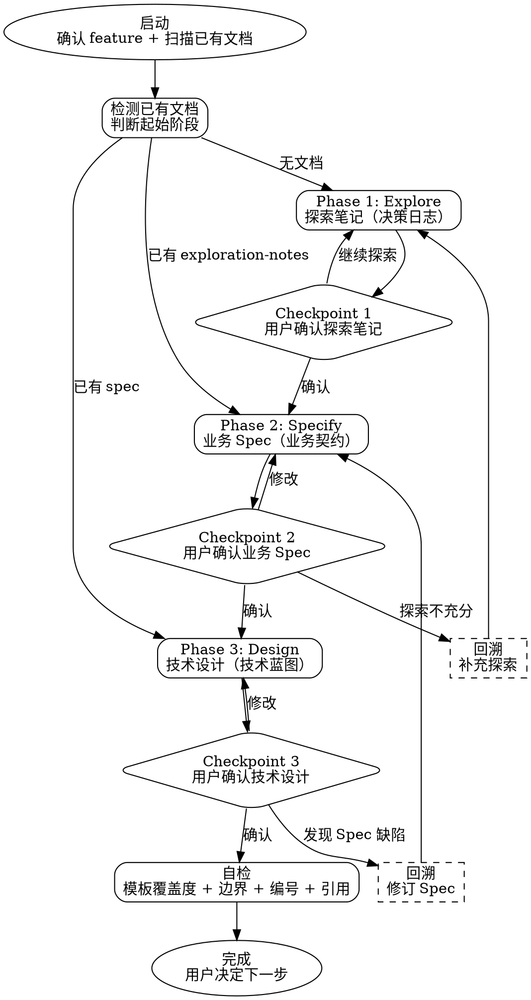

# Spec Workflow — 三阶段文档产出流程

从探索到设计的规范化工作流，产出三份边界清晰的文档：

| 阶段 | 文档 | 定位 | 核心问题 |
|------|------|------|----------|
| Phase 1 | `exploration-notes.md` | 决策日志 | 我们决定了什么？为什么？ |
| Phase 2 | `spec.md` | 业务契约 | 系统必须满足哪些业务规则和场景？ |
| Phase 3 | `design.md` | 技术蓝图 | 怎么在 V3 架构下落地？ |

**核心原则：每份文档只回答自己的问题，不越界。**

## Checklist

启动后按此 checklist 推进，每完成一项打勾：

### 启动检查
- [ ] 确认 feature 名称和输出目录 `specs/<feature>/`
- [ ] 扫描已有文档，判断从哪个 Phase 开始
- [ ] 读取 `docs/rules/global-baseline.md` 和 `docs/rules/coding-enforcement.md`

### Phase 1: Explore（决策日志）
- [ ] 加载 `references/exploration-notes-template.md`
- [ ] 自然对话探索，覆盖 6 大议题方向
- [ ] 产出 `exploration-notes.md`
- [ ] 用户确认 → checkpoint

### Phase 2: Specify（业务契约）
- [ ] 加载 `references/spec-template.md`
- [ ] 从探索笔记提炼规则/场景
- [ ] 产出 `spec.md`
- [ ] 用户确认 → checkpoint

### Phase 3: Design（技术蓝图）
- [ ] 加载 `references/design-template.md`
- [ ] 读取 DDD 规范（`docs/rules/ddd/ddd-architecture-overview.md` 等）
- [ ] 产出 `design.md`
- [ ] 用户确认 → checkpoint

### 收尾
- [ ] 自检：模板覆盖度 + 边界检查 + 编号一致性 + 交叉引用
- [ ] 告知用户三阶段完成，可进入 writing-plans 或编码

## 流程图



## 阶段跳转逻辑

### 启动时自动检测

启动后扫描 `specs/<feature>/` 目录：

| 已有文档 | 起始阶段 | 行为 |
|----------|----------|------|
| 无 | Phase 1 | 从头开始 |
| `exploration-notes.md` | Phase 2 | 总结已有探索，直接进 Specify |
| `exploration-notes.md` + `spec.md` | Phase 3 | 总结已有 Spec，直接进 Design |
| 三份都有 | 提示用户 | 问是否要更新某份文档 |

### --phase 参数

用户可通过 `--phase=2` 直接跳到指定阶段。跳转前仍需读取前序文档作为上下文。

### 回溯机制

任何阶段发现前序文档不充分时，可以回溯：

- **Phase 2 → Phase 1**：探索笔记缺少关键决策，需要补充探索
- **Phase 3 → Phase 2**：技术设计中发现 Spec 遗漏了规则或场景

**回溯规则：**
1. 向用户说明回溯原因（具体缺了什么）
2. 用户确认后才回溯，不得自行决定
3. 回溯后以追加模式更新前序文档，不覆盖已有内容
4. 补充完成后回到原阶段继续

---

## Phase 1: Explore（决策日志）

### 目标

通过自然对话探索业务问题，产出 `exploration-notes.md` 作为后续阶段的决策依据。

### 行为指引

1. **加载模板**：Read `references/exploration-notes-template.md`，了解产出格式
2. **检查已有上下文**：扫描 `specs/*/` 下已有的探索笔记、proposal、tasks
3. **自然对话探索**：按 6 大议题方向（业务范围、系统架构、业务规则、系统协作、领域建模、数据架构）展开对话
4. **覆盖度检查**：每 4-5 轮对话后，用表格展示 6 大议题的覆盖状态
5. **捕获决策**：讨论中形成的决策，提议写入探索笔记（用户确认后才写）

### 探索立场

- 好奇而非说教，开放而非审讯
- 一次一个话题，但心里有全景
- 诚实而非讨好——对每个回答都有立场
- 扎实——探索实际代码库，不空谈理论

### 写入规范

- 追加而非覆盖，多次会话用 `---` 分隔
- 结论优先于过程——记录决定了什么，不是完整对话
- 问题追踪同步——已确认的决策对应的问题从「待解决」移到「已解决」

### 完成条件

用户确认探索笔记可以进入 Phase 2。没有强制结尾——探索可能只覆盖部分议题就足够了。

### 禁止

- 禁止编写应用代码
- 禁止在探索笔记中出现 Java 代码、技术选型细节、接口签名
- 禁止自动捕获决策——必须提议后由用户确认

---

## Phase 2: Specify（业务契约）

### 目标

从探索笔记中提炼业务规则和场景，产出 `spec.md` 作为编码的业务契约。

### 行为指引

1. **加载模板**：Read `references/spec-template.md`，了解产出格式
2. **读取探索笔记**：完整阅读 `exploration-notes.md`，提取已确认的决策
3. **分段产出**：
   - 先写目标和业务概念（从探索笔记直接提取，确定性高）
   - 再写业务规则 BR-XXX（标注置信度：✅ 探索笔记明确 / ⚠️ 推导的）
   - 再写业务场景 SC-XXX（GIVEN/WHEN/THEN 格式）
   - 最后写领域模型定义和约束
4. **分段确认**：每个大章节写完后暂停，等用户确认再推进

### 主动挑战

- 探索笔记用了模糊措辞（"通常"、"一般"）→ 主动追问具体行为
- 多种合理实现都说得通 → 列出选项让用户拍板
- 规则涉及异常/并发/空值 → 主动提出边界场景

### 编号规范

- 业务规则：`BR-<域缩写>-<三位数>`，如 `BR-BUY-001`
- 业务场景：`SC-<域缩写>-<三位数>`，如 `SC-BUY-001`
- 约束：`CON-<三位数>`，如 `CON-001`
- 编号在同一 spec.md 内递增不重复

### 完成条件

用户确认 spec.md 可以进入 Phase 3。

### 禁止

- 禁止出现 Java 代码块（含注解的类定义）
- 禁止出现技术选型（框架、中间件、缓存方案）
- 禁止出现接口签名的技术细节（HTTP method、URL path、序列化格式）
- 禁止出现 Repository、Adaptor、Infrastructure 等技术组件
- 禁止重复定义已在基础 spec 中全局维护的领域模型字段

---

## Phase 3: Design（技术蓝图）

### 目标

基于业务 Spec 和 V3 架构规范，产出 `design.md` 作为编码的技术蓝图。

### 行为指引

1. **加载模板**：Read `references/design-template.md`，了解产出格式
2. **加载 DDD 规范**（必须在产出前完成）：
   - `docs/rules/ddd/ddd-architecture-overview.md`（六层架构 + 四种开发模式 + 分层 Bean 模型表）
   - `docs/rules/practical/practical-orchestration.md`（Application 编排加严）
   - 当前层相关的 `docs/rules/ddd/ddd-<layer>-layer.md`
3. **读取前序文档**：完整阅读 `exploration-notes.md` 和 `spec.md`
4. **逐章节产出**：
   - 目标（对应 BR/SC/CON 编号）
   - 开发模式标注（V3 四种模式）
   - 模块与包结构
   - 接口签名设计（方法名 + 输入 + 输出 + 职责一句话，按层分组）
   - 数据模型（PO/DTO 字段表）
   - 流程设计（时序图/流程图，PlantUML 或 Mermaid）
   - 状态机（补充实现策略）
   - 错误码映射表
   - 缓存与性能决策
   - V3 规范对应说明
5. **分段确认**：每个大章节写完后暂停，等用户确认

### 抽象级别控制

**设计文档的定位**：让熟悉 V3 规范的工程师能直接据此开始 coding，但不能让不熟悉 V3 的人照着抄代码。

| 允许 | 禁止 |
|------|------|
| 模块/包结构 | Java 代码块（含 `@Value @Builder` 注解的类定义） |
| 接口签名表（方法名+输入+输出+职责一句话） | 方法体伪代码（除规则/算法外） |
| 数据模型字段表 | `try/catch` 异常处理器代码 |
| 流程图/时序图 | Controller 方法体 |
| 状态机 + 实现策略 | 完整的 Spring 配置代码 |
| 错误码映射表 | |
| 缓存/性能/监控决策 | |

### 完成条件

用户确认 design.md 完成。

### 禁止

- 禁止出现 Java 代码块（含注解的类定义、方法体实现）
- 禁止写方法体伪代码（规则/算法除外）
- 禁止未读 DDD 规范就动手产出
- 禁止假设"通用 DDD"——必须用项目实际的 V3 六层架构

---

## 自检清单

三阶段全部完成后，执行以下自检：

### 1. 模板覆盖度

对照每份模板的章节列表，逐项检查产出文档是否覆盖（已覆盖 / 不适用 / 遗漏）。

### 2. 边界检查

| 检查项 | 方法 |
|--------|------|
| exploration-notes 不含技术选型 | 搜索关键词：`@Value`、`@Builder`、`implements`、`extends`、`pom.xml` |
| spec 不含 Java 代码 | 搜索 ` ```java` 代码块 |
| design 不含方法体 | 搜索 `{` + `return` + `throw` 组合 |

### 3. 编号一致性

- spec.md 中所有 BR-XXX 编号递增不重复
- spec.md 中所有 SC-XXX 编号递增不重复
- design.md 中引用的 BR/SC/CON 编号在 spec.md 中都存在

### 4. 交叉引用

- design.md 的「目标」章节引用了 spec.md 的 BR/SC/CON
- design.md 的领域模型与 spec.md 的领域模型定义一致
- spec.md 的业务概念与 exploration-notes.md 的关键决策一致

---

## 禁止事项汇总

| 禁止 | 原因 |
|------|------|
| 跳过前序文档直接产出 | 没有上下文的产出大概率是错的 |
| 未读 DDD 规范就写 design.md | 会假设通用 DDD，与 V3 偏离 |
| 在 exploration-notes 写 Java 代码 | 探索笔记是决策日志，不是技术方案 |
| 在 spec.md 写技术选型 | spec 是业务契约，不关心怎么实现 |
| 在 design.md 写方法体 | 设计是蓝图，不是代码 |
| 自动推进到下一阶段 | 每个 checkpoint 必须用户确认 |
| 自行决定回溯 | 回溯必须告知原因并获得用户确认 |
| 覆盖已有文档 | 已有内容追加更新，不全量覆盖 |

---

## 终态

三阶段完成、自检通过后，告知用户：

```
## Spec Workflow 完成：<feature>

**已产出：**
- exploration-notes.md — 决策日志（N 个关键决策，M 个待解决问题）
- spec.md — 业务契约（X 条规则，Y 个场景，Z 个约束）
- design.md — 技术蓝图（模块结构 + 接口签名 + 数据模型 + 流程图）

**下一步（用户自行决定）：**
- `superpowers:writing-plans` → 生成 task-by-task 实施计划
- `superpowers:test-driven-development` → 直接进入 TDD 编码
- 继续探索 / 修订某份文档
```

Skill 到此结束，不替用户做下一步决策。
